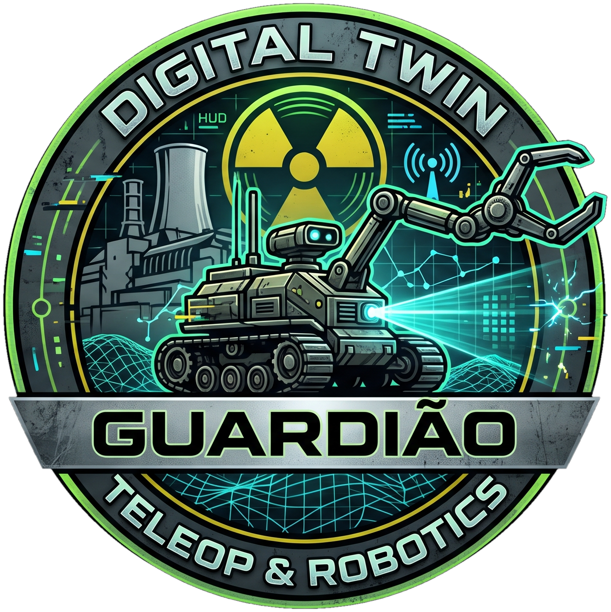
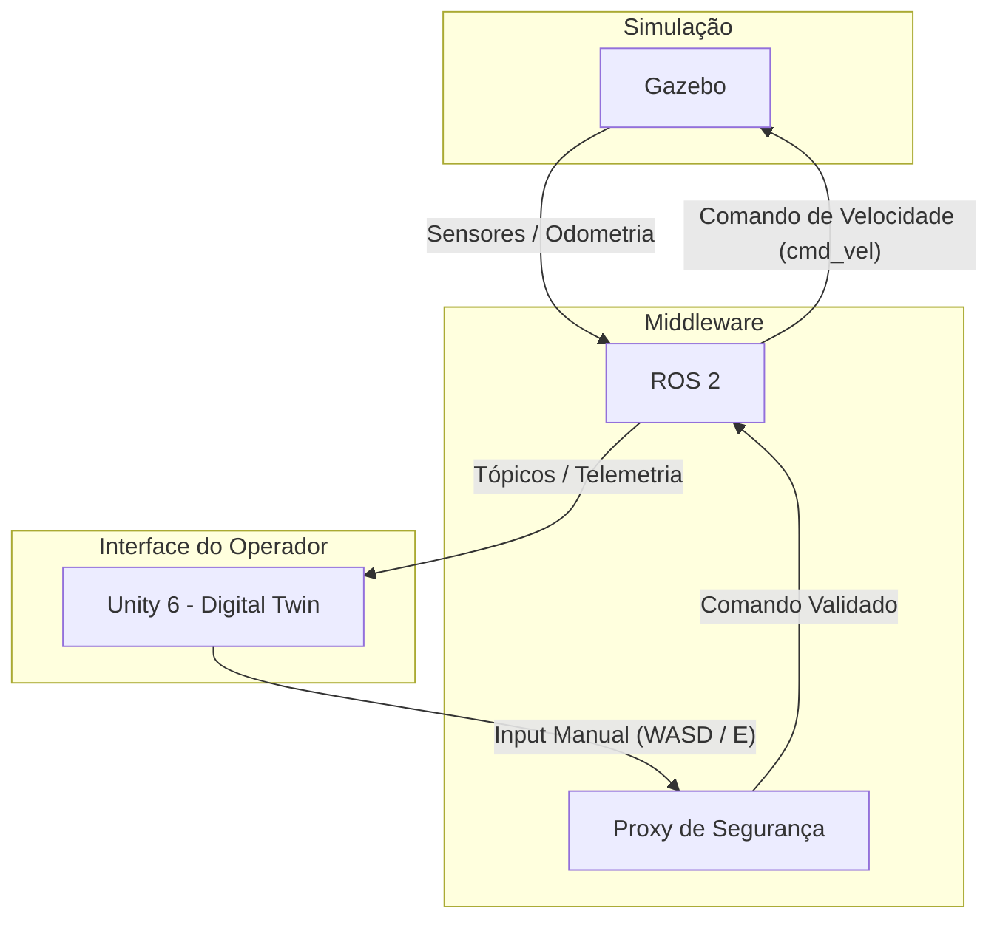

<p align="center">
  
</p>

# Projeto 2 | Guardião — Digital Twin & Teleoperação 🤖

> Sistema de gêmeo digital e teleoperação para inspeção remota em cenários de risco radiológico, combinando simulação interativa na **Unity 6** com a arquitetura robótica de **ROS 2** e **Gazebo**.

<p align="center">
  
  
  
</p>

## ✨ Visão geral

O **Guardião** (`DigitalTwin_Chernobyl`) simula um robô móvel (`robo-base` com modelo visual alinhado `robo-color`) operando em um cenário inspirado nas instalações de Chernobyl (`cherobylu`). O sistema combina patrulha autônoma com desvio por leque de raios rentes ao chão, paredes delimitadoras até a área do reator (`Zona_Reator`), dosímetro em tempo real na tela (`HUD_Radiacao` / `DetectorRadiacaoHUD.cs`) e alternância imediata para controle manual (`WASD`) via tecla `E` (`EmergenciaManual`), além da integração conceitual e de telemetria com **ROS 2** e **Gazebo**.

## ☢️ O Cenário: Inspeção em Área Contaminada

O ambiente 3D (`cherobylu`) reproduz uma área urbana e industrial com aproximação à estrutura do reator, permitindo testar navegação autônoma, monitoramento de radiação em `µSv/h` e intervenção humana em situações de risco:

- **Unity 6 (`SampleScene` / `cherobylu`):** executa o robô (`robo-base` e modelo `robo-color`), detecção de obstáculos por leque de `Raycast` (`RobotController.cs`), acompanhamento de câmera (`CameraController.cs`), paredes invisíveis de percurso (`Parede_Guia_01`), zona de radiação (`Zona_Reator`) e interface de dosimetria (`DetectorRadiacaoHUD.cs`).
- **ROS 2 e Gazebo:** representam o middleware de comunicação/tópicos e a simulação física complementar para cinemática, sensores e validação de comandos.

## 🧭 Navegação

- [Funcionalidades](#-funcionalidades)
- [Arquitetura](#️-arquitetura-do-sistema)
- [Estrutura](#-estrutura-do-repositório)
- [Pré-requisitos](#️-pré-requisitos)
- [Execução](#️-como-executar)
- [Demonstração](#-vídeo-de-demonstração)
- [Colaboradores](#️-colaboradores)

## 🚀 Funcionalidades

| Área              | O que está disponível                                                                                                     |
| ----------------- | ------------------------------------------------------------------------------------------------------------------------- |
| **Locomoção**     | `Rigidbody` com `Freeze Rotation` nos eixos `X` e `Z` para evitar tombamentos, além de movimentação manual por `WASD`.    |
| **Percepção**     | Leque de `Raycast` rente ao chão (`alturaOrigemSensor`), escolha inteligente do lado de giro e watchdog anti-travamento.  |
| **Rota e Zona**   | Barreiras invisíveis (`Parede_Guia_01`) com `Box Collider` na `Layer Obstaculos` até a `Zona_Reator` (cálculo em `µSv/h`). |
| **Dosímetro HUD** | Painel **GUARDIÃO // DOSÍMETRO** (`DetectorRadiacaoHUD.cs`) exibindo `µSv/h`, status (`SEGURO`, `ALERTA`, `CRÍTICO`) e modo. |
| **Integração**    | Mapeamento para **ROS 2** e **Gazebo** cobrindo comandos de velocidade, sensores/obstáculos e telemetria de radiação.     |

### Modos de controle e atalhos

- **`Autonomo`:** patrulha contínua pelo corredor até a área do reator, com desvio automático de obstáculos e recuperação anti-travamento.
- **`EmergenciaManual` (tecla `E`):** alterna entre controle autônomo e controle manual direto pelo teclado (`W`, `A`, `S`, `D`) para manobras em áreas críticas.

## 🏗️ Arquitetura do Sistema



### Mapeamento para ROS 2 e Gazebo

- **Movimento e teleoperação (`cmd_vel`):** corresponde às velocidades linear e angular aplicadas durante a patrulha autônoma ou no modo `EmergenciaManual` (`WASD`), com prioridade do operador ao pressionar `E`.
- **Leque de sensores e desvio:** corresponde à leitura de proximidade/obstáculos (`Raycast` na `Layer Obstaculos`) e à seleção do lado com maior espaço livre.
- **Dosímetro e zona crítica (`/radiation` / `µSv/h`):** corresponde à proximidade do robô em relação à `Zona_Reator` e à classificação de risco exibida no `DetectorRadiacaoHUD`.

## 📁 Estrutura do Repositório

```text
├── gazebo_ros_ws/                    # Workspace do ROS 2 (backend e simulação)
│   ├── src/                          # Código-fonte dos nós em Python/C++
│   ├── launch/                       # Arquivos de inicialização (.launch.py)
│   └── urdf/                         # Modelos 3D do robô para o Gazebo
├── unity_digital_twin/               # Pasta base do gêmeo digital na Unity
│   └── teste-do-mapa/                # Projeto principal da Unity 6 (abrir no Unity Hub)
│       ├── Assets/
│       │   ├── models/               # Modelos 3D (robô, cenário, assets)
│       │   ├── Scenes/               # Cenas da Unity (SampleScene / cherobylu)
│       │   └── scripts/              # RobotController.cs, CameraController.cs, ZonaRadiacao.cs, DetectorRadiacaoHUD.cs
│       ├── Packages/                 # Dependências e pacotes da Unity
│       └── ProjectSettings/          # Configurações do projeto Unity 6
├── logo_guardiao.png                 # Logotipo oficial do projeto Guardião
├── .gitignore                        # Arquivos temporários/cache ignorados pelo Git
└── README.md                         # Documentação do projeto
```

## 🛠️ Pré-requisitos

Para rodar o projeto em outro computador sem problemas:

- **Unity Hub & Unity Editor (Unity 6)** com suporte a projetos 3D padrão/URP, conforme a cena.
- **Git** instalado para clonar e atualizar o repositório.
- **ROS 2 Humble e Gazebo** (opcionais se você for rodar apenas a simulação interativa na Unity 6; necessários para a camada ROS 2/Gazebo).

## ⚙️ Como Executar

### 1. Clonar e abrir o projeto na Unity 6

Clone o repositório e entre na pasta do projeto:

```bash
git clone https://github.com/viictorrx/digital-twin-teleop.git
cd digital-twin-teleop
```

1. Abra o **Unity Hub**, clique em **Add → Add project from disk** e selecione especificamente a pasta `unity_digital_twin/teste-do-mapa` (não apenas `unity_digital_twin`).
2. Aguarde a Unity 6 importar os Assets e Packages na primeira abertura.
3. Abra a cena principal (`SampleScene`, contendo o ambiente `cherobylu` e o `robo-base`).

### 2. Conferir a cena antes de apertar Play (caso abra em máquina limpa)

- **`robo-base`:** verifique se possui o componente `Rigidbody` com `Freeze Rotation` marcado em `X` e `Z` (deixando `Y` livre), o `RobotController.cs` com a `Layer Obstaculos` configurada e o modelo visual `robo-color` alinhado.
- **`Parede_Guia_01` (e duplicatas):** confirme que os objetos-guia ao longo do trajeto têm `Box Collider` e estão na mesma `Layer Obstaculos` lida pelo sensor do robô.
- **`Zona_Reator`:** confirme que o objeto na área do reator possui `Sphere Collider` (`Is Trigger` marcado) e o script `ZonaRadiacao.cs` (`Radiacao Maxima` e `Raio Zona` configurados).
- **`HUD_Radiacao`:** confirme que existe um objeto na cena com o script `DetectorRadiacaoHUD.cs` e com os campos `Alvo Robo` e `Robot Controller` apontando para o `robo-base`.

### 3. Testar a simulação na Unity 6

1. Clique em **Play (▶)** na barra superior da Unity.
2. Observe o `robo-base` patrulhar pelo corredor até a `Zona_Reator`, enquanto o painel **GUARDIÃO // DOSÍMETRO** no canto superior direito atualiza o valor em `µSv/h` e o estado de risco.
3. Pressione `E` para alternar entre `Autonomo` e `EmergenciaManual`, e use `W` `A` `S` `D` para mover manualmente.

### 4. Camada ROS 2 / Gazebo (quando aplicável)

```bash
cd gazebo_ros_ws
colcon build
source install/setup.bash
ros2 launch meu_pacote_robo simulacao.launch.py
```

## 🎥 Vídeo de Demonstração

[                              ]

## ✍️ Colaboradores

- Gustavo Moreira Silva
- Victor Souza Ferreira
- Vinícius Geronimo da Costa
- Matheus Ferreira Vieira
- Pedro Augusto Brito Castilho Pereira
